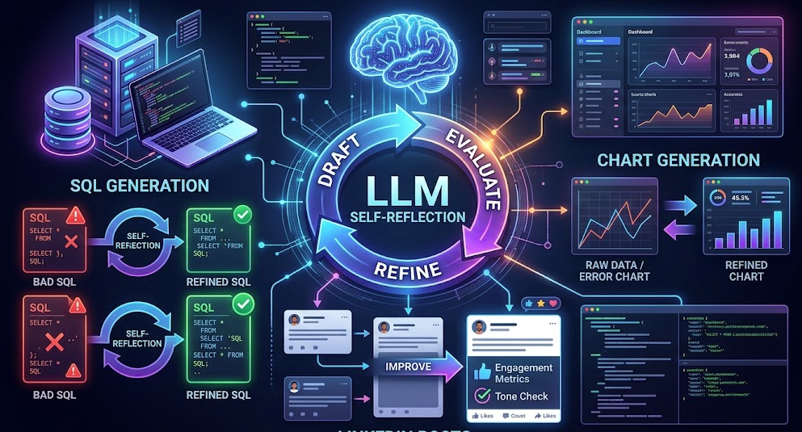

  <!-- Replace the 'src' link below with the actual path to your image (e.g., ./images/reflection.png) -->
  
  
  <h1>🧠 AI Reflection Projects</h1>
  
<i>Exploring how self-correction makes AI generation smarter and more accurate.</i>

---

## 🤔 What is "Reflection" in AI?

In the world of Artificial Intelligence, **Reflection** (often called self-reflection or self-correction) is a technique where an AI model is asked to act as its own critic. Instead of just giving you its first guess, the AI takes a step back to review its own work before presenting the final answer. 

It involves a simple loop:
1. **Generate:** The AI creates an initial draft or solution.
2. **Reflect:** The AI critiques its own draft (checking for errors, tone, logic, or missing information).
3. **Revise:** The AI generates an improved version based on its own critique.

### The Effect of Reflection
Using reflection drastically improves the quality of AI outputs. It reduces "hallucinations" (made-up facts), catches logical or coding errors before they break your system, and refines the tone of written content to perfectly match what you actually want.

---

## 💡 A Simple Example

Imagine you ask an AI to write a short, professional email. 

* **Without Reflection:** The AI writes the email, but it accidentally uses a super casual tone and uses the word "dude."
* **With Reflection:** 
  * *Draft:* The AI writes the email with the word "dude".
  * *Reflection:* The AI pauses and thinks, *"Wait, the user asked for a professional tone. 'Dude' is too casual."*
  * *Final Output:* The AI rewrites the email using professional language and delivers a flawless result.

---

## 📂 Projects in this Repository

This repository contains three distinct projects that demonstrate the power of AI reflection across different use cases. 

### 1. 📝 Generating LinkedIn Posts
**Folder:** `linkedin-post-reflection`
Writing a good social media post requires the right hook and tone. In this project, the AI generates a first draft of a LinkedIn post, reflects on how engaging and professional it is, and then revises it to ensure it will capture the audience's attention and drive engagement.

### 2. 🗄️ Generating SQL Queries
**Folder:** `sql-generation-reflection`
Writing database queries can be tricky, and one small error can break the code. This project explores how AI can write an initial SQL query, reflect on the database schema and syntax rules to catch potential errors, and output a corrected, fully functional query ready for production.

### 3. 📊 Generating Charts
**Folder:** `chart-generation-reflection`
Data visualization needs to be accurate and easy to read. In this project, the AI generates code (like Python/Matplotlib) to create a chart. It then reflects on the visual clarity, axes labels, and color choices, revising the code to produce a beautiful, highly readable chart.

---

